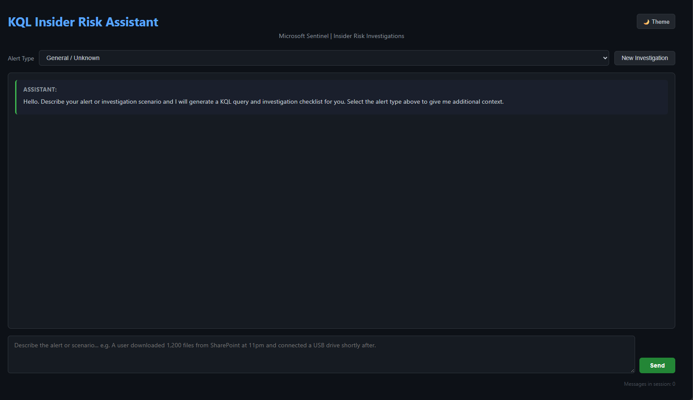

# KQL Insider Risk Assistant

A local web app that helps security analysts investigate **insider risk alerts in Microsoft Sentinel**. Describe an alert in plain English and the assistant returns ready-to-run **KQL queries**, a plain-English explanation of each one, and a tailored **investigation checklist**, all powered by the Claude API.

It is built for SOC analysts, especially junior ones, who need to move quickly from "an alert fired" to "here is what to check next".



## Quick start

```bash
git clone https://github.com/Danemma0/KQL-Assistant.git
cd KQL-Assistant
python -m venv venv
venv\Scripts\activate          # macOS/Linux: source venv/bin/activate
pip install -r requirements.txt
cp .env.example .env            # Windows: copy .env.example .env, then add your ANTHROPIC_API_KEY
python app.py
```

Then open <http://localhost:5000>. You need Python 3.10+ and an [Anthropic API key](https://console.anthropic.com/). See [Getting started](#getting-started) for details.

> **Disclaimer:** Generated queries should always be reviewed and validated in your own Sentinel environment before use. Table and field names can differ between workspaces. This tool does not connect to Sentinel and does not run queries.

---

## Use cases

- Triage of Microsoft Purview **DLP**, **UEBA**, **EDR** and **CASB** alerts
- Pre-termination or resignation data-theft investigations
- Mass file download and exfiltration checks (USB, email, cloud upload)
- After-hours or out-of-scope access reviews
- Building a personal library of proven KQL queries
- Reviewing and sanity-checking KQL before running it in production
- Training junior analysts, because explanations and checklists are included
- Producing a concise PDF write-up for case files or handover

---

## Tech stack

| Layer | Technology |
|---|---|
| Backend | Python, Flask |
| AI | Anthropic Claude API |
| Storage | SQLite (local file) |
| PDF | ReportLab |
| Frontend | Vanilla HTML/CSS/JS, highlight.js, marked |

---

## Getting started

### Prerequisites
- Python 3.10+
- An [Anthropic API key](https://console.anthropic.com/)

### Setup

```bash
git clone https://github.com/Danemma0/KQL-Assistant.git
cd KQL-Assistant

python -m venv venv
# Windows
venv\Scripts\activate
# macOS / Linux
source venv/bin/activate

pip install -r requirements.txt

# Add your API key
cp .env.example .env      # Windows: copy .env.example .env
# then edit .env and set ANTHROPIC_API_KEY
```

### Run

```bash
python app.py
```

Open <http://localhost:5000>. The SQLite database (`kql_assistant.db`) is created automatically on first run.

---

## Privacy and masking

Sensitive values in your investigation scenarios **never leave your machine in plain text**.

### How it works
- **Email addresses / UPNs**, **IPv4 / IPv6 addresses**, **FQDNs / hostnames**, and **`DOMAIN\user`** patterns are automatically detected and replaced with consistent tokens such as `EMAIL_1`, `IP_2`, `HOST_3`, `USER_4` before the message is sent to the Claude API.
- You can also define **custom always-mask terms** (project code-names, employee names, etc.) in the input area.
- The token-to-value map is stored **locally only** in `kql_assistant.db` and never sent to any external service.
- Claude receives only the token placeholders. Its replies — which also contain tokens — are reversed before you see them, so you always read the real values in the chat.
- Use the **Preview →** button to inspect exactly what will be sent before you hit Send.
- Masking is **on by default** but can be toggled off per message if needed.

> **Note:** Even with masking on, the structural context of your scenario (table names, KQL patterns, alert type) is still sent to the API. Use placeholders for any remaining sensitive context.

### Still applies
- Your API key lives only in `.env` (git-ignored). Never commit it.
- Investigation history is stored locally in `kql_assistant.db` (git-ignored).
- This is a local dev tool. Do not expose it to a network without hardening (disable debug, add authentication, use a production server).

---

## Features

### Sensitive-data masking (Priority 1)
- Automatic regex detection of emails, IPs, hostnames, `DOMAIN\user`, and custom terms.
- Reversible tokenisation — same value always gets the same token within a case.
- KQL code blocks are never touched, so queries stay valid.
- Preview panel + masked-items badge in the UI.
- Full unit-test suite in `tests/test_masking.py`.

### Persistent conversations (Priority 2)
- Each investigation has a `conversation_id`. Clicking a sidebar entry **restores** the full chat so you can continue where you left off.
- **Search** investigations by keyword. **Rename** or **delete** individual cases.
- Conversation messages are persisted in `conversation_messages` table; mask tokens stored in `mask_sessions`.

### Streaming responses (Priority 3)
- `/query` streams tokens via Server-Sent Events as they are generated.
- A **Stop** button aborts the stream mid-flight.
- The system prompt uses **prompt caching** to reduce latency and cost on repeated calls.
- **Token usage** (input / output / cache hits) is shown after each reply.

### Front-end hardening (Priority 4)
- All dynamic HTML is sanitised with **DOMPurify** before being inserted into the DOM.
- User-typed text is escaped with `createTextNode` before any `innerHTML` assignment.

---

## Project structure

```
.
├── app.py              # Flask routes: chat (streaming), history, PDF export, library, query review
├── database.py         # SQLite schema and migrations
├── masking.py          # PII masking/unmasking module
├── system_prompt.py    # System prompt: KQL and insider-risk expertise
├── requirements.txt
├── .env.example
├── tests/
│   └── test_masking.py
├── templates/
│   └── index.html
└── static/
    ├── script.js
    └── style.css
```

### API routes

| Method | Route | Purpose |
|---|---|---|
| GET | `/` | Web UI |
| POST | `/query` | Send a scenario, get streaming queries and checklist |
| POST | `/preview_mask` | Preview what will be sent to Claude after masking |
| GET | `/history[?q=keyword]` | Recent saved conversations (with search) |
| GET | `/conversation/<id>` | Load full conversation for restore |
| PATCH | `/conversation/<id>` | Rename conversation title |
| DELETE | `/conversation/<id>` | Delete conversation and all messages |
| GET | `/export/<id>` | Download investigation as PDF |
| GET / POST | `/library` | List or save library queries |
| PATCH / DELETE | `/library/<id>` | Rename, update or delete a library query |
| POST | `/review_query` | Claude review of a KQL query |
| POST | `/reset` | Clear the in-memory conversation state |

---

## Licence

Released under the [MIT License](LICENSE).

